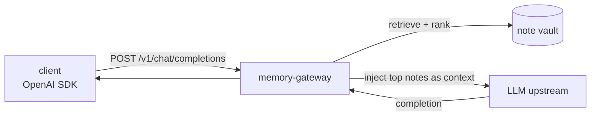

# memory-gateway

An OpenAI-compatible chat proxy that gives a local LLM long-term memory. Before
forwarding a request upstream, it pulls the most relevant notes from a note
vault, ranks them by relevance and governance, and injects them as context.

## What it does
- Exposes `POST /v1/chat/completions` (plus `/v1/models`, `/health`) as a
  drop-in OpenAI endpoint, then forwards to the real LLM upstream
- Retrieves candidate notes per request and **ranks** them by relevance,
  freshness, knowledge class and source priority
- Applies governance: unreviewed or overdue runbook/fix notes are down-weighted,
  while maintenance reports and conflicts are pulled in for ops and security
  questions
- Keeps stored knowledge from overriding a correction the user has just made

## Why the ranking is opinionated
Putting every match into the prompt degrades the answer. The gateway uses
per-question **retrieval profiles** (`ops`, `security`, `source`, `general`), so
an operations question surfaces runbooks and incident timelines first, while a
factual question prefers evergreen knowledge. Raw sources are held back as
fallback context.

## Stack
- **Python**, FastAPI, httpx
- **Hardened container**: read-only root filesystem, non-root user, dropped
  capabilities, `no-new-privileges`

## Config
Everything is environment-driven: upstream URL, memory API URL, note and context
limits, and a bearer token (`GATEWAY_API_TOKEN`) required on every call. No
secrets or network addresses live in this repository, so you bring your own
configuration.

MIT licensed.

## About this snapshot

The vault behind this is personal, so the private repo contains note paths,
profile weights tuned to my own content, and the upstream address. The publishing
script takes those out, swaps internal addresses for placeholders, and will not
push until two secret scanners are both satisfied.

That is also why the history here starts at the first release instead of at the
beginning. The gateway sits in front of my own local model.
